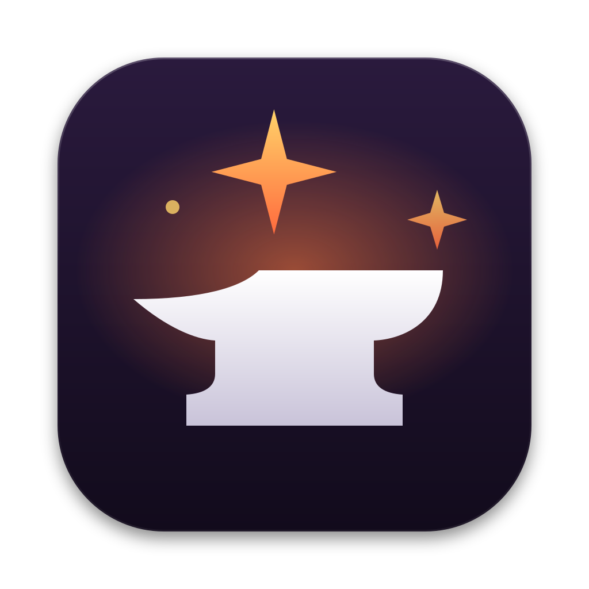
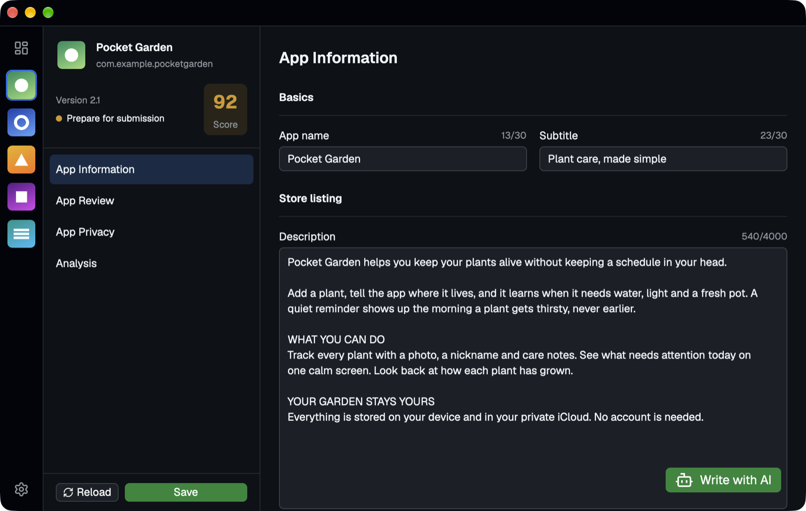
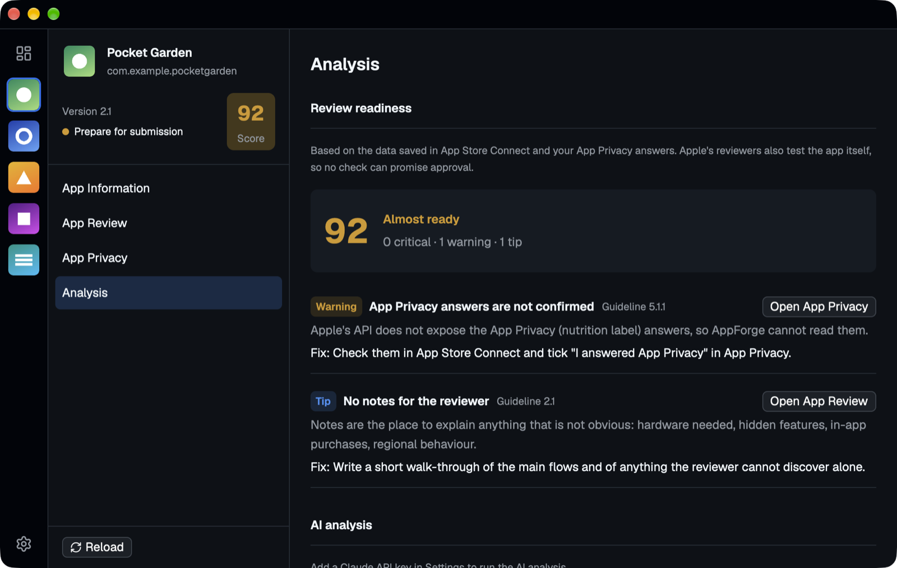

#  AppForge

AppForge gets your App Store apps ready for review: edit every listing, see what could get an app
rejected before you submit, and let an AI write the store texts from your project. A native macOS
app built with Rust and [GPUI Kit](https://gpui-kit.com), in English and Türkçe.

| App Information · Write with AI | Analysis · Review readiness |
| --- | --- |
|  |  |

Both screenshots show made-up demo apps.

- **Your apps** — Every app of your App Store Connect account, with its icon, in a bar on the left or as a grid. Open one to edit **App Information** (name, subtitle, description, keywords, promotional text, URLs, what's new), **App Review** (contact, demo account, notes) and **App Privacy**. Only the fields you changed are sent to Apple.
- **Analysis** — Built-in rules and an optional AI review read the saved data against the [App Store Compliance Playbook](https://github.com/mjmirza/app-store-compliance) and give a score, with the guideline, what is wrong and how to fix it for every finding.
- **Write with AI** — Choose the folder that holds an app's source code, press one button, and the subtitle, description, keywords, promotional text and what's new are written for you to read, change and save. Only low-cost Claude and OpenAI models are offered, with their prices, and every run says what it cost.
- **Private by design** — Sign-in uses an App Store Connect API key, which stays in the macOS Keychain, as do your AI keys. Secrets in your project are never read.
- **Appearance** — Follows macOS Light and Dark, set in the Geist typeface.

## Get started

AppForge supports macOS 15 or later on Apple Silicon. See [GitHub Releases](https://github.com/cagatayldzz/appforge/releases) for downloads, or follow the [development guide](docs/development.md) to run it from source.

```sh
bun run dev
```

The first launch walks you through creating an API key in App Store Connect, which takes about two minutes. Google Play is planned.

## Documentation

- [Usage](docs/usage.md) — signing in, the apps and their pages, Write with AI, analysis and settings
- [Development](docs/development.md) — platform, commands, packages, releases and tests
- [Architecture](docs/architecture.md) — crates, code map, window layout and the data folder
- [Project rules](AGENTS.md) — conventions for contributors and AI agents
